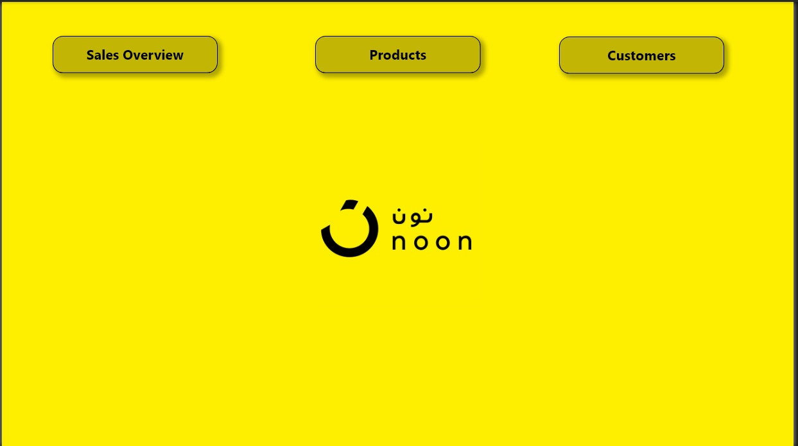
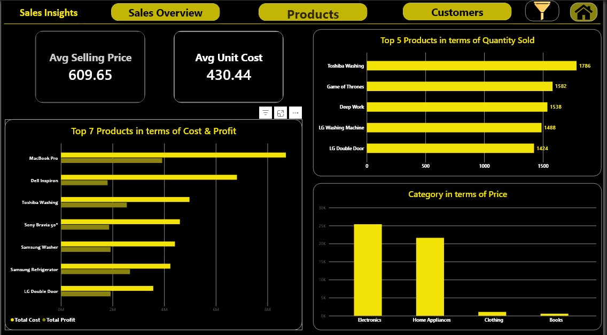

# Sales Analysis Dashboard (Power BI)

An interactive 4-page Power BI dashboard that analyzes sales performance across products, categories, customers and locations.

> **Tools:** Power BI Desktop · DAX · Star Schema Data Modeling
> **Data source:** _[write the source here, e.g. Kaggle dataset name / link]_

## Business Questions

- How much are we selling and how profitable is it?
- Which products and categories drive the most sales, quantity and profit?
- How do sales change month by month?
- Who are the top customers, and how do customers differ by gender and state?

## Data Model

The model follows a **star schema**: one fact table connected to five dimension tables.

| Table | Type | Used for |
|---|---|---|
| `Fact_Sales` | Fact | Sales Amount, Quantity, Total Cost, Total Profit |
| `Dim_Product` | Dimension | Product name, unit price, average selling price / unit cost |
| `Dim_Category` | Dimension | Category name |
| `Dim_Customer` | Dimension | Customer name, gender, customer KPIs |
| `Dim_Location` | Dimension | State |
| `Dim_Date` | Dimension | Month name / time analysis |

**Key measures:** Total Sales, Total Profit, Total Cost, Quantity Sold, Avg Selling Price, Avg Unit Cost, Total Customers, Sales per Customer, Profit per Customer, Orders per Customer.

## Dashboard Pages

### 1. Home
Landing page with navigation buttons to the other pages.



### 2. Sales Overview
- KPI cards: **Total Sales**, **Total Profit**, **Quantity Sold**
- Top 10 products by sales
- Sales amount by category
- Sales amount by month (trend)
- Slicers: State, Category, Gender, Product, Month


### 3. Products
- Top 5 products by quantity sold
- Top 7 products by cost & profit
- Category vs. unit price
- Avg selling price and avg unit cost cards



### 4. Customers
- Total customers, sales / profit / orders per customer
- Top 7 customers by sales
- Quantity split by gender (donut chart)
- Customers by state


## Interactivity

- Cross-filtering slicers on every page (State, Category, Gender, Product, Month)
- Bookmarks to open / close the slicer panel
- Page navigation buttons

## Key Insights

_Fill these with your real findings from the dashboard, for example:_

1. **Top category:** ... generates ...% of total sales.
2. **Best-selling product:** ... with ... units sold.
3. **Seasonality:** sales peak in ... and drop in ...
4. **Customers:** the top 7 customers account for ...% of sales.

## Repository Structure

```
├── README.md
├── dashboard/
│   └── task_8.pbix
├── data/            (dataset or a link to it)
└── images/          (dashboard screenshots)
```

## How to Open

1. Download `dashboard/task_8.pbix`.
2. Open it with **Power BI Desktop** (free, Windows).
3. If Power BI asks for the data source, point it to the files in `data/`.

## Author

**Mahmoud Magdy Barakat** — Accounting student & aspiring Data Analyst
[LinkedIn](#) · [GitHub](#)
