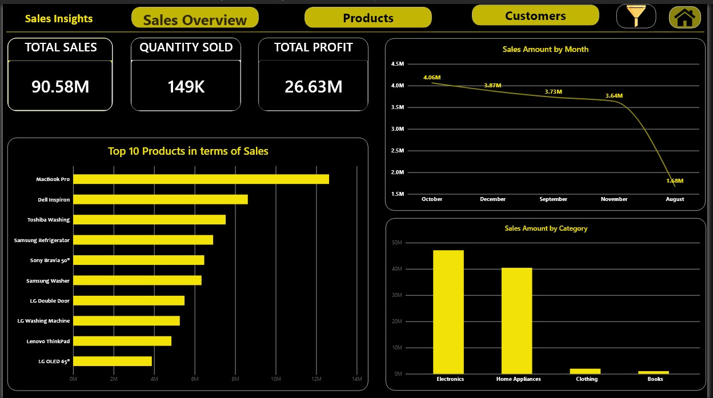
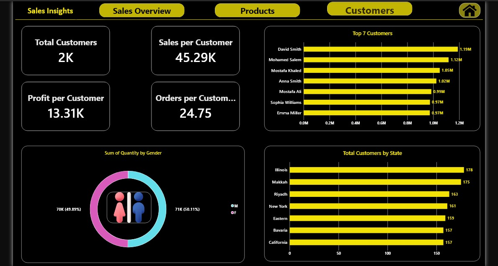

# Sales Analysis Dashboard \| Power BI

An interactive, 4-page Power BI dashboard built to explore sales
performance across products, categories, customers, and locations.

## Project Overview

This project provides a consolidated view of sales performance and
profitability. It helps users explore key business metrics, compare
product and category performance, monitor monthly sales trends, and
understand customer behavior across genders and states.

**Tools & Technologies** - Power BI Desktop - DAX - Star Schema Data
Modeling

## Business Questions

The dashboard is designed to answer the following business questions:

-   How much are we selling, and how profitable are sales?
-   Which products and categories contribute the most to sales,
    quantity, and profit?
-   How do sales change from month to month?
-   Who are the top customers?
-   How does customer behavior differ by gender and state?

## Data Model

The data model follows a **Star Schema**, with one fact table connected
to five dimension tables.

  -----------------------------------------------------------------------
  Table                   Type                    Description
  ----------------------- ----------------------- -----------------------
  `Fact_Sales`            Fact                    Sales amount, quantity,
                                                  total cost, and total
                                                  profit

  `Dim_Product`           Dimension               Product name, unit
                                                  price, average selling
                                                  price, and unit cost

  `Dim_Category`          Dimension               Product category

  `Dim_Customer`          Dimension               Customer name, gender,
                                                  and customer-related
                                                  attributes

  `Dim_Location`          Dimension               State or sales location

  `Dim_Date`              Dimension               Date attributes used
                                                  for monthly and
                                                  time-based analysis
  -----------------------------------------------------------------------

## Key Measures

The report includes the following measures:

-   Total Sales
-   Total Profit
-   Total Cost
-   Quantity Sold
-   Average Selling Price
-   Average Unit Cost
-   Total Customers
-   Sales per Customer
-   Profit per Customer
-   Orders per Customer

## Dashboard Pages

### 1. Home

A landing page with navigation buttons to access the other report pages.


### 2. Sales Overview

A high-level view of sales performance, including:

-   KPI cards for **Total Sales**, **Total Profit**, and **Quantity
    Sold**
-   Top 10 products by sales
-   Sales amount by category
-   Monthly sales trend
-   Slicers for State, Category, Gender, Product, and Month



### 3. Products

A product-focused page that includes:

-   Top 5 products by quantity sold
-   Top 7 products by cost and profit
-   Category comparison by unit price
-   KPI cards for average selling price and average unit cost


### 4. Customers

A customer-focused page featuring:

-   Total customers
-   Sales, profit, and orders per customer
-   Top 7 customers by sales
-   Quantity distribution by gender
-   Customer distribution by state



## Interactivity

The report includes:

-   Cross-filtering slicers across the report pages
-   Slicers for State, Category, Gender, Product, and Month
-   Bookmarks to show or hide the slicer panel
-   Page navigation buttons

## Analysis Scope

The dashboard supports analysis of:

-   Overall sales and profitability
-   Product and category performance
-   Monthly sales movement
-   Customer contribution and purchasing behavior
-   Sales distribution by gender and state

The report is intended to help users identify performance patterns and
explore the factors contributing to sales and profit.

## Repository Structure

``` text
.
├── README.md
├── dashboard/
│   └── noon_sales_analysis.pbix
├── data/
│   └── source dataset (if shared separately)
└── images/
    ├── 01_home.png
    ├── 02_sales_overview.png
    ├── 03_products.png
    └── 04_customers.png
```

## How to Open the Dashboard

1.  Download the Power BI file from the `dashboard` folder.
2.  Open it using **Power BI Desktop**.
3.  If Power BI requests the data source, reconnect it to the source
    dataset.
4.  Refresh the data if required.

## Author

**Mahmoud Magdy Barakat**\
Data Analyst
